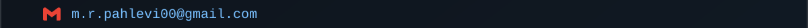
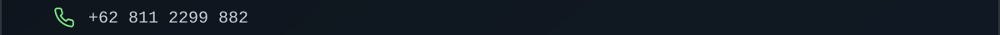
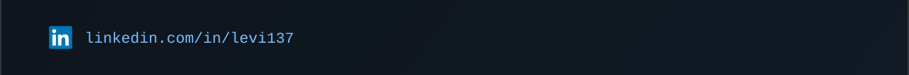
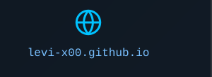
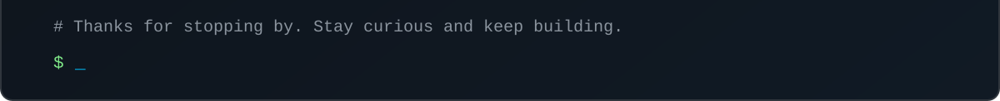

<!--
  The terminal is six images stacked with no gaps: terminal-top.svg, four contact rows, terminal-bottom.svg.
  It is split because GitHub only makes a whole image clickable, never a link drawn inside one.
  Keep the four contact row tags concatenated with no spaces between them; each is full width, so they stack one per line.
  To change any wording, edit the matching <text> line in the SVG files.
  Still placeholder text: currently_building.
  The mission section is commented out inside terminal-top.svg.
-->

<div align="center">
<a href="https://github.com/levi-x00"></a>
<a href="mailto:m.r.pahlevi00@gmail.com"></a><a href="https://github.com/levi-x00"></a><a href="https://www.linkedin.com/in/levi137/"></a><a href="https://levi-x00.github.io"></a>
<a href="https://github.com/levi-x00"></a>
</div>

<!--
## 04 / Selected work

| Project | What it does | Built with |
| --- | --- | --- |
| [**Project One**](https://github.com/levi-x00) | One sentence about the problem it solves. | `Tech` `Tech` `Tech` |
| [**Project Two**](https://github.com/levi-x00) | One sentence about its most interesting feature. | `Tech` `Tech` |
| [**Project Three**](https://github.com/levi-x00) | One sentence about the result or impact. | `Tech` `Tech` |

> Replace these examples with your best three projects. Specific outcomes are more memorable than long descriptions.
-->

<!--
## 05 / How I work

```text
Understand the problem → Design the simplest solution → Build → Test → Improve
```

- I prefer clear, maintainable code over clever code.
- I document decisions so future contributors can move faster.
- I treat feedback and mistakes as part of the build process.
-->

<!--
  Hidden because GitHub cannot show live images or clickable links inside an SVG.
  Uncomment any block to display it below the terminal.

<div align="center">
  <a href="https://github.com/levi-x00?tab=followers">
    
  </a>
  
</div>

<div align="center">
  
  
</div>

<div align="center">
  <a href="mailto:m.r.pahlevi00@gmail.com">
    
  </a>
  <a href="https://www.linkedin.com/in/levi137/">
    
  </a>
  <a href="https://levi-x00.github.io">
    
  </a>
</div>


-->
